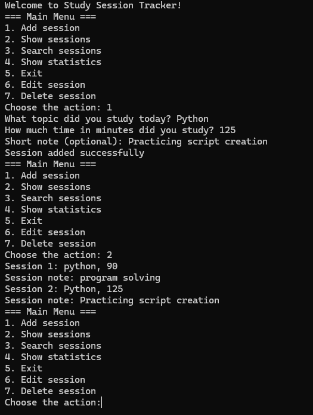

# Study Session Tracker

Study Session Tracker is a Python console application for tracking study sessions. I created this project to practice the basic concepts of Python and learn how to develop small programs independently

# Features

- Adding study sessions with a topic, duration, and note
- Viewing all saved sessions
- Searching for sessions by topic
- Editing individual fields of a session
- Deleting sessions with confirmation
- Calculating statistics: total study time, number of sessions, average duration, longest and shortest sessions
- Automatically saving data to a text file and restoring it when the program is restarted
- Validating user input and handling errors

# Technologies

- Python 3
- Python standard library
- Text files for data storage

No additional libraries are required.

# How to Run

1. Download the `tracker.py` file from the repository
2. Make sure Python 3 is installed
3. Open a terminal in the folder containing the file
4. Run the command:

```bash
python tracker.py
```

The program will display a text-based menu. To perform an action, enter the corresponding number. Data is saved to the `sessions.txt` file, which is created automatically.

# What I Learned

During the development of this project, I practiced and deepened my understanding of the following topics:

- Indentation and code block structure (to prevent code from being placed inside the wrong `if` or `for` block, or after `return`)
- Variables, functions, and return values (to avoid situations where functions are called without storing their results)
- Conditional statements and logical operators (to avoid confusion between `=`, `==`, `is not`, `not`, and `or`)
- Lists, dictionaries, and other data types

## Screenshots

### Viewing Study Sessions


### Study Statistics

- Loops and program execution order (to avoid calling functions or using variables before they are defined in the program's execution flow)
- User input validation and exception handling
- Reading and writing text files

This project was my first experience building a complete console application that combines multiple functions and preserves data between runs
